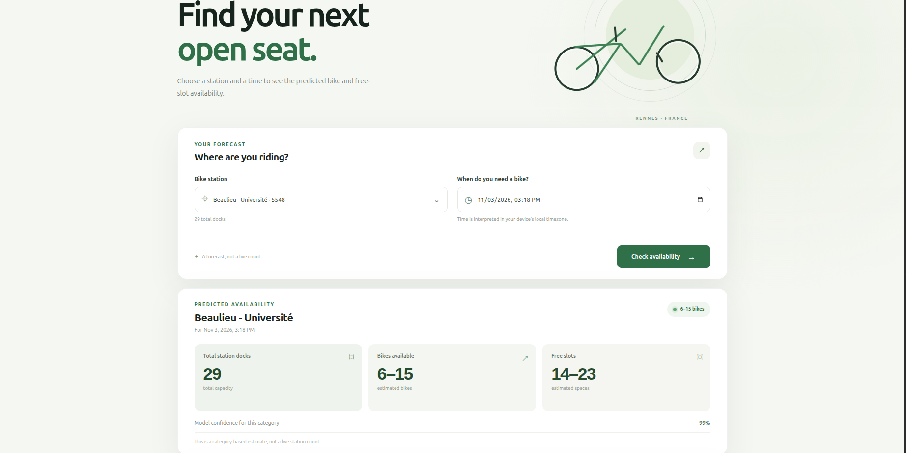

# 🚲 Velo availability: bike availability estimates for Rennes

A web app that estimates how many bikes and free docks you can expect at a bike-share station in Rennes, for a chosen station and date/time.

**[Live demo](https://velo-disponibility.onrender.com/)** (free hosting: the first load can take about a minute)



## What it does

- Pick a station and a local date/time, and get an estimated range of bikes and free docks.
- See a Monday to Sunday comparison for the selected station (typical weekday pattern).
- Use the same predictions through a REST API (FastAPI, interactive docs at `/docs`).

> **Note:** this is a learning project. The model estimates the *typical* availability for a station at a given time. It is not a live forecast and does not use the current state of the station.

## How it works

1. **Data:** station readings are collected from the Rennes Métropole open data API (`data.rennesmetropole.fr`, Le Vélo STAR stations) every 20 minutes and stored locally.
2. **Cleaning:** keep stations in operation, drop inconsistent rows (free docks + bikes ≠ total docks), convert timestamps to Paris time.
3. **Target:** the number of bikes is grouped into 7 classes: `0`, `1-2`, `3-5`, `6-15`, `16-19`, `20-25`, `26+`.
4. **Features:** station, station capacity, hour of day, day of week and a weekend flag.
5. **Model:** a Random Forest classifier (scikit-learn), chosen after comparing it with logistic regression and a decision tree.
6. **Serving:** FastAPI turns the predicted class and its probabilities into bike and free-dock ranges, using each station's capacity.
7. **Frontend and deployment:** a Vite web interface served by the same FastAPI app, packaged with Docker and deployed on Render.

## Results

Evaluated on a stratified 80/20 split, with macro F1 as the main metric because the classes are unbalanced.

| Model | Accuracy | Macro F1 |
|---|---|---|
| Baseline: most common class per station, hour and weekday | 0.532 | 0.099 |
| Logistic regression | 0.23 | 0.156 |
| Decision tree | 0.718 | 0.643 |
| **Random Forest (used in the app)** | 0.727 | 0.646 |


## Limitations

- **Random split:** rows from the same station and hour, 20 minutes apart, can land in both train and test. Scores are therefore optimistic compared with predicting truly future data.
- **Short history:** the data covers a limited period, so rare days (holidays, events, bad weather) are not well represented.
- **Simple features:** no weather, no holidays, no recent values of the station. The model cannot react to what is happening right now.
- **Ranges, not exact counts:** the output is a class converted to a range.

## Project layout

```
api/            FastAPI service (predictions, stations, weekly comparison)
frontend/       Vite web interface
src/            feature and model code (training script)
notebooks/      data cleaning and model evaluation
tests/          automated tests
data/           collected readings and prepared datasets
models/         saved model (created by training)
Dockerfile      image with API, frontend and model
render.yaml     Render deployment blueprint
collector/      Docker service that polls the open data API every 20 minutes
```


## Run it locally

Requirements: Python 3.12 or newer, Node.js 20 or newer.

```bash
python3 -m venv .venv
source .venv/bin/activate
pip install -r requirements.txt
```

**1. Prepare the data and compare models**

Run all cells in `notebooks/data_cleaning.ipynb`. The last cell saves `data/clean.parquet`, `data/train.parquet` and `data/test.parquet`. Then open `notebooks/model_evaluation.ipynb` to compare the models.

**2. Train the model used by the API**

```bash
python -m src.train
```

This loads `data/train.parquet` and saves `models/availability_classifier.joblib`. Use `--train-data` and `--model-output` to choose other paths.

**3. Start the API**

```bash
uvicorn api.main:app --reload
```

Open http://127.0.0.1:8000/docs.

**4. Start the frontend (development)**

```bash
cd frontend
npm install
npm run dev
```

Open the URL printed by Vite (usually http://localhost:5173). If the API runs on another address, copy `frontend/.env.example` to `frontend/.env.local`, set `VITE_API_URL`, and restart Vite.

## API

| Endpoint | Description |
|---|---|
| `GET /stations` | list of stations |
| `POST /predict` | estimate for one station at one time |
| `POST /predict/day` | 24-hour estimates for a specific date |
| `POST /predict/week` | average Monday to Sunday pattern for a station |

Example request:

```json
{
  "station_id": 5505,
  "requested_at": "2026-10-28T15:00:00+01:00"
}
```

The response gives the predicted class, bike and free-dock ranges, and the station capacity. Estimated bikes and free docks add up to the capacity.

## Docker and deployment

```bash
docker build -t velo-disponibility .
docker run --rm -p 8000:8000 velo-disponibility
```

Open http://localhost:8000. The image builds the frontend and serves it from FastAPI, together with the model and station metadata.

To deploy on Render, connect this repository as a Blueprint. Render reads `render.yaml` and builds the Dockerfile. The free plan sleeps after inactivity and is meant for hobby projects, not production.

## Possible next steps

- Evaluate with a time-based split (train on the past, test on the future).
- Add weather and holiday features.
- Add recent station values to estimate short-term availability.
- Track experiments and add model monitoring.

## Tech stack

Python · pandas · scikit-learn · FastAPI · Vite · Docker · Render